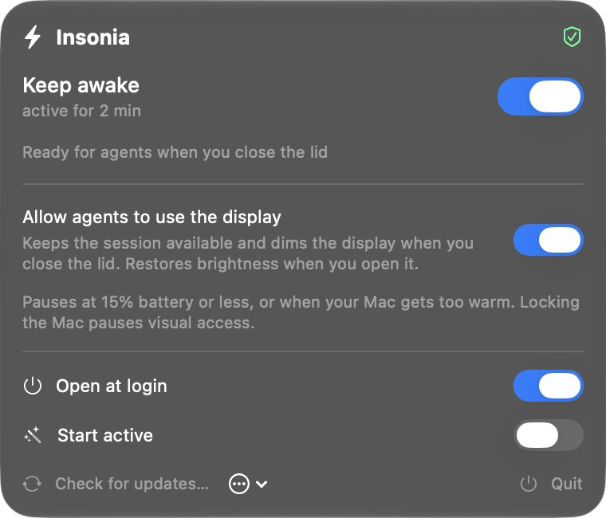

<p align="center">
  
</p>

# Insonia

**Keep your Mac awake, even with the lid closed.**

A native macOS menu bar app for long-running work, with optional display access for visual agents, automatic recovery, and an interface that follows your Mac's language.

**[Download for Mac](https://github.com/reyhenrick/insonia/releases/latest/download/Insonia-macOS.dmg)** · [All releases](https://github.com/reyhenrick/insonia/releases)

macOS **26 or later**. Universal binary for Apple silicon and compatible Intel Macs. Free and open source under the [MIT license](LICENSE).

<p align="center">
  
</p>

## Install and start

1. Download and open **Insonia-macOS.dmg**.
2. Drag **Insonia** to **Applications**, then open it from Applications. You can eject the disk image afterward.
3. Click the **lightning bolt in the menu bar** to open the panel.
4. Choose **Install system protection** and approve the native macOS administrator prompt.
5. Turn on **Keep awake** and wait for activation to be confirmed.

**First opening:** this release is signed ad hoc and has no Apple Developer ID signature or notarization. If macOS blocks the first launch, go to **System Settings → Privacy & Security → Open Anyway** and confirm **Open**, following [Apple's instructions](https://support.apple.com/en-us/102445). Managed Macs may restrict this option.

The disk image includes an English guide with installation, usage, and troubleshooting instructions. A [ZIP archive](https://github.com/reyhenrick/insonia/releases/latest/download/Insonia-macOS.zip) and [SHA-256 checksums](https://github.com/reyhenrick/insonia/releases/latest/download/SHA256SUMS.txt) are also available.

## Choose how you work

- **Keep awake** keeps background tasks running with the lid closed. With agent access off, the display can sleep. Right-click the menu bar icon to toggle it directly.
- **Allow agents to use the display** preserves an already unlocked graphical session. Enable it with the lid open and your Mac unlocked. Closing the lid dims the built-in display to at most 1%; reopening it or ending the session restores the saved brightness. External displays are unchanged.
- **Open at login** launches Insonia when you sign in.
- **Start active** requests Keep awake when the app launches. After a protective interruption, start the next session manually.

Manual locking, user switching, and system policies can pause visual access. Insonia preserves macOS authentication; it does not unlock the Mac or change FileVault. Your agent needs its own Screen Recording and Accessibility permissions. Check a real capture, click, and typing action with that agent before relying on closed-lid work.

## Protection and recovery

**System protection** lets Insonia change sleep behavior and recover if a session fails. A privileged service restores normal sleep when the app stops responding, and a separate recovery monitor restores saved display brightness. **Protection ready** means these services are responding. Installing or updating protection uses the native macOS administrator prompt.

Insonia pauses an active session at **15% battery or less when unplugged**, when it cannot check the battery while unplugged, when macOS reports serious or critical thermal pressure, or when recovery services need attention. Read the reason in the panel, resolve it, and turn Keep awake on when you are ready. **Repair monitor** and **Update system protection** are available when needed.

Keep your Mac on a ventilated surface while it stays awake.

## Stay up to date

Insonia checks for releases automatically while it is open. Choose **Check for updates…** to check now. **Update available** and a blue dot on the menu bar icon indicate an available update. Installation asks for your approval by default. To receive and install releases automatically, enable **Install updates automatically** in the **…** menu.

A downloaded update waits for **Keep awake** to be off, normal sleep and brightness to be restored, and any protection operation to finish. Turn off Keep awake when your work finishes to allow installation. The first launch after an update starts with Keep awake off; your **Start active** preference remains saved for later launches.

Updates come from GitHub Releases. Insonia verifies the feed and downloaded archives with Ed25519 signatures before installation. See the [security policy](SECURITY.md) for the distribution and verification details.

## Your Mac's language, automatically

The interface supports **English, Portuguese, Spanish, French, German, and Italian**, following macOS language preferences with English as the fallback. Adjust **System Settings → General → Language & Region** and reopen Insonia to change the language. Project documentation and the bundled guide are in English.

## Privacy

Power control and recovery run locally, with no account or analytics. The updater contacts GitHub and its download infrastructure; the hosting service receives ordinary request metadata such as your IP address. System profiling is disabled. Local recovery records contain power and session events, not screenshots or window contents.

## Remove Insonia

1. Turn off **Keep awake** and **Open at login**.
2. Choose **… → Remove protection…**, approve the macOS prompt, and wait for Insonia to restore normal sleep, remove its services, and close.
3. Move **Insonia.app** from Applications to the Trash.

## Build and contribute

Bug reports, translations, compatibility testing, documentation, and code contributions are welcome under the MIT license. Read [CONTRIBUTING.md](CONTRIBUTING.md) for setup, checks, and release signing. Report vulnerabilities through the [private security channel](SECURITY.md).

With Xcode, a macOS 26 SDK or newer, and Python 3:

```sh
git clone https://github.com/reyhenrick/insonia.git
cd insonia
./test.sh
./build.sh
```

The Swift and SwiftUI build creates `build/Insonia.app` without installing privileged services. Use `scripts/package-release.sh` to prepare the downloadable archives locally.

[Release notes](CHANGELOG.md) · [Report an issue](https://github.com/reyhenrick/insonia/issues/new/choose) · [MIT license](LICENSE)
